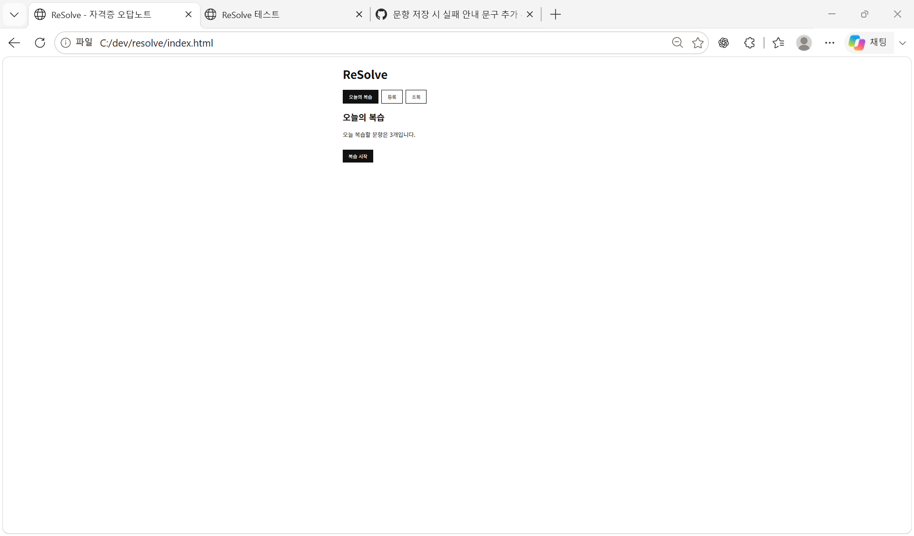
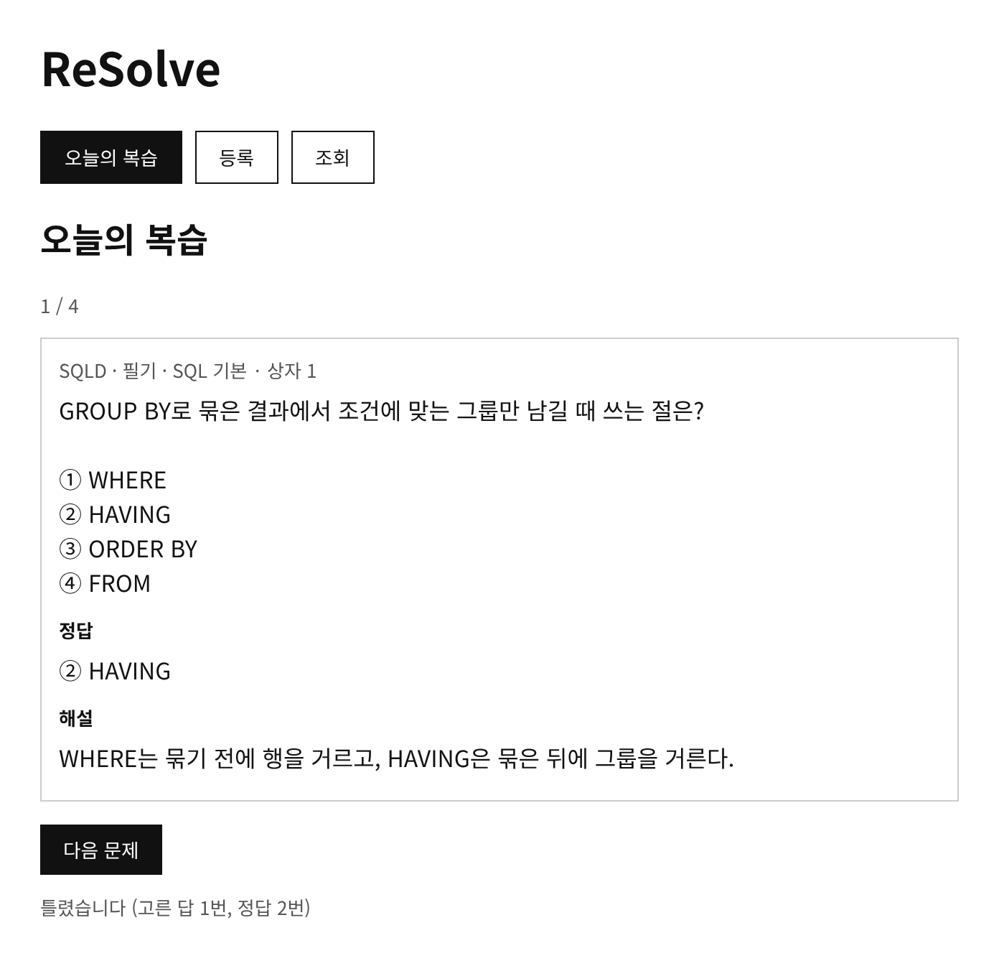
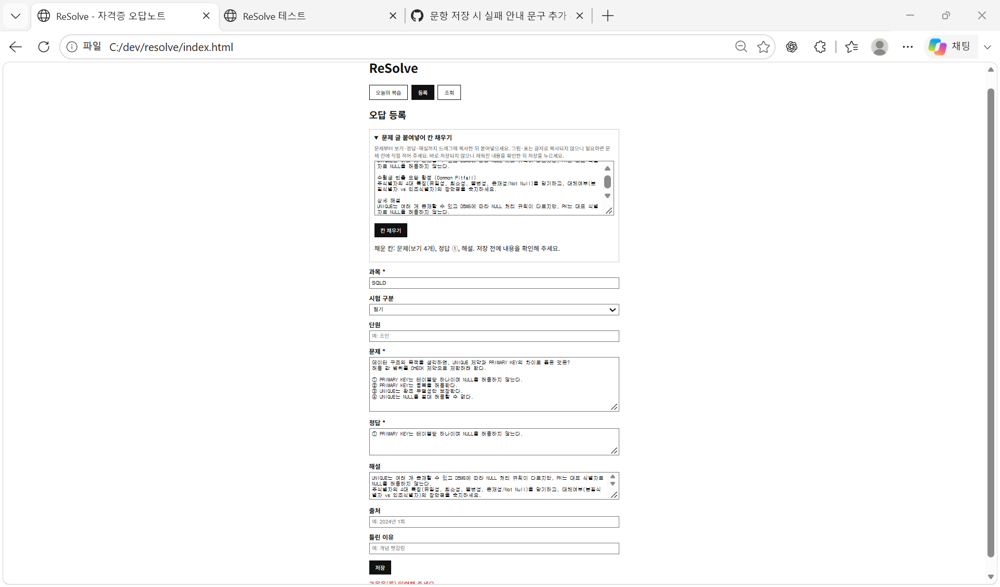
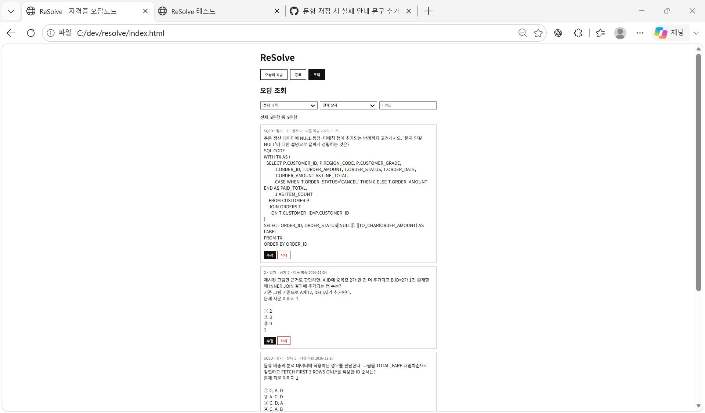
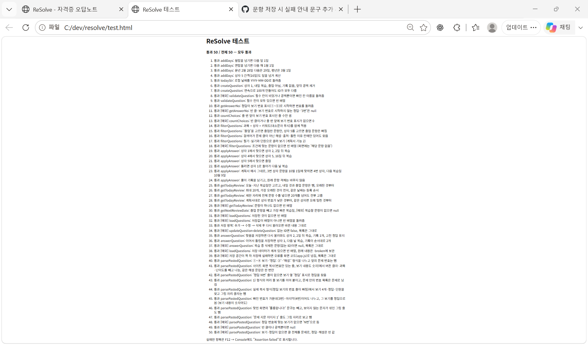

# ReSolve: 자격증 오답노트 웹 프로그램

필기와 실기 기출문제를 풀다 틀린 문항을 등록하면, Leitner 상자 방식으로 다음 복습 날짜를 정해 정해진 간격에 맞추어 다시 풀게 해 주는 JavaScript 웹 프로그램입니다. 프로그램을 설치하지 않고 브라우저에서 `index.html`을 열어 바로 씁니다.

## 1. 프로젝트 소개

IT 자격증은 필기, 실기 모두 보통 회차별 기출문제를 반복해서 풀며 준비합니다. 틀린 문제를 문제집에 표시하거나 휴대폰으로 캡처해 두면 기록이 여러 곳에 흩어지고, 언제 다시 볼지 정해 두지 않아 시험 직전에 몰아서 보거나 아예 다시 보지 않게 됩니다. ReSolve는 필기와 실기 오답을 한곳에 모아 두고, 문항마다 다음 복습 날짜를 프로그램이 정해 줍니다.

- 목표 사용자: 전공 무관 모든 IT 자격증 응시자
- 1차 대상: 컴퓨터활용능력, 정보처리산업기사, SQLD, ADsP처럼 회차별 기출문제를 반복해서 풀며 준비하는 IT 자격증 응시자
- 채점: 보기와 정답 번호가 있는 객관식은 보기 번호를 먼저 골라 바로 채점합니다. 실기처럼 보기가 없는 문항은 코드 실행이나 엑셀 결과 확인 같은 자동 채점을 하지 않고, 사용자가 정답과 비교해 스스로 채점합니다.

복습 날짜는 복습 간격을 점점 늘려 가는 Leitner 상자 방식으로 정합니다. 맞히면 다음 상자로, 틀리면 1번 상자로 옮깁니다.

| 상자 | 1번 | 2번 | 3번 | 4번 | 5번 |
|---|---|---|---|---|---|
| 다음 복습까지 | 1일 | 2일 | 4일 | 8일 | 16일 |

- 새 문항은 1번 상자에 들어가 다음 날부터 복습에 나옵니다.
- 5번 상자에서 또 맞히면 완료로 보고 더 내지 않습니다. 화면에는 "졸업"으로 표시됩니다.
- 예) 3번 상자 문항을 10월 1일에 맞히면 4번 상자로 옮겨지고 다음 복습일은 10월 9일입니다.

## 2. 실행 환경과 필요한 패키지

- 필요한 것: 크롬(Chrome)이나 엣지(Edge) 같은 최신 브라우저 하나. 개발과 확인은 Windows의 크롬(버전 157.0.8103.80)과 엣지(버전 157.0.4341.60)에서 했습니다.
- 설치할 프로그램, 패키지, 외부 라이브러리가 없습니다. 그래서 requirements.txt나 package.json도 없습니다.
- 서버 없이 HTML·CSS·JavaScript 파일만으로 동작하고, 인터넷 연결도 필요 없습니다.

## 3. 설치법

1. 저장소를 내려받습니다. 둘 중 하나를 쓰면 됩니다.
   - Git: `git clone https://github.com/KJinu201/resolve.git`
   - 웹: GitHub 저장소 화면에서 Code → Download ZIP을 누른 뒤 압축을 풉니다.
2. 내려받은 폴더에서 `index.html` 파일을 더블클릭하면 브라우저에서 바로 시작합니다.

주의할 점
- 데이터는 브라우저 저장소(localStorage)에 저장됩니다. 다른 브라우저나 다른 컴퓨터에서는 보이지 않으니 항상 같은 브라우저로 여세요.
- 브라우저 기록(사이트 데이터)을 지우면 등록한 문항도 함께 지워집니다. 아직 백업 기능이 없으니 주의하세요.
- 브라우저는 주소마다 저장 공간을 따로 씁니다. 파일을 직접 연 경우(`file://...`)와 VSCode Live Server로 연 경우(`http://127.0.0.1:...`)는 서로 다른 저장 공간이라, 한쪽에서 등록한 문항이 다른 쪽에서는 보이지 않습니다. 한 가지 방법으로만 여세요.

## 4. 사용법

화면 위의 메뉴 3개(오늘의 복습 / 등록 / 조회)로 화면을 바꿉니다.

**오답 문항 등록**
1. 등록 화면에서 시험 구분(필기/실기), 과목, 단원, 문제, 정답, 해설, 출처(시행 회차), 틀린 이유를 적고 저장을 누릅니다.
2. 과목·문제·정답은 꼭 적어야 합니다. 비어 있거나 공백뿐이면 저장하지 않고 빠진 칸을 알려 줍니다.
3. 여러 줄인 실기 답도 정답 칸에 그대로 적을 수 있습니다.

**문제 글 붙여넣어 칸 채우기**
1. 온라인으로 푼 문제를 문제부터 보기·정답·해설까지 드래그해 복사합니다.
2. 등록 화면 위의 "문제 글 붙여넣어 칸 채우기"를 열고 붙여넣은 뒤 칸 채우기를 누릅니다.
3. 단원·문제(보기 ①~⑤ 포함)·정답·해설 칸이 채워집니다. 바로 저장되지 않으니 내용을 확인하고 저장을 누릅니다.
   - 이미 적어 둔 칸이 바뀌게 되면 먼저 물어봅니다.
   - 찾지 못한 칸은 안내 문구로 알려 줍니다.
   - 그림과 표는 글자로 복사되지 않으니 필요하면 문제 칸에 직접 적습니다.
   - 단원까지 채우려면 문제 위의 과목·단원 표시 줄부터 복사합니다.

**오늘의 복습**
1. 첫 화면에 오늘 복습할 문항 수가 나옵니다. 복습 날짜가 오늘이거나 지난 문항이 대상이고, 상자 번호가 낮은 것부터, 같은 상자면 오래 밀린 것부터 최대 20개를 냅니다. 복습할 문항이 없으면 다음 복습일을 알려 줍니다.
2. 복습 시작을 누르면 문제가 나옵니다.
   - 객관식(보기와 정답 번호가 있는 문항): 보기 번호 버튼 중 하나를 고르면 바로 "맞았습니다" 또는 "틀렸습니다 (고른 답, 정답)"가 나오고 정답과 해설이 펼쳐집니다. 다음 문제를 누르면 결과가 저장됩니다. 한 번 고른 번호는 바꿀 수 없습니다.
   - 실기 등 보기가 없는 문항: 답을 떠올린 뒤 정답 보기를 누르고, 정답과 비교해 맞았어요 / 틀렸어요 중 하나를 누릅니다.
3. 결과가 저장되면 방금 문항이 몇 번 상자로 옮겨졌는지와 다음 복습일이 표시됩니다.
4. 다 풀거나 그만하기를 누르면 푼 문항 수와 맞음·틀림 수가 나옵니다. 풀지 않은 문항은 복습일이 그대로라 다음에 다시 나옵니다.
5. 복습 중에 다른 화면에 다녀와도 풀던 문제부터 이어서 풉니다.

**문항 조회와 검색**
1. 조회 화면에서 과목, 필기·실기, 단원, 상자 번호(1~5번, 졸업), 키워드로 골라 봅니다. 조건은 함께 적용되고, 맞는 문항이 없으면 "해당 문항 없음"이 나옵니다. 키워드는 문제·정답·해설·단원·틀린 이유·출처에서 찾고, 영문 대소문자는 구분하지 않습니다.
2. 수정을 누르면 등록 화면에 내용이 채워집니다. 고쳐도 상자 번호와 다음 복습일, 풀이 기록은 그대로 남습니다.
3. 삭제를 누르면 한 번 더 물어본 뒤 지웁니다.

**바로 퀴즈를 보고 싶을 때 (확인용)**

새 문항은 다음 날부터 복습에 나오므로, 등록한 날에는 오늘의 복습이 비어 있습니다. 바로 퀴즈 화면을 확인하려면 `index.html`을 연 상태에서 F12 → Console에 아래 한 줄을 넣고 Enter를 누른 뒤 새로고침(F5)합니다. 모든 문항의 복습일이 오늘로 바뀝니다.

```js
saveQuestions(loadQuestions().map(q => ({ ...q, nextReview: todayStr() })))
```

## 5. 테스트 실행 방법

1. 내려받은 폴더에서 `test.html`을 더블클릭해 브라우저로 엽니다. 명령어로 열려면 Windows 명령 프롬프트에서 폴더로 이동한 뒤 `start test.html`을 입력합니다.
2. 화면 맨 위에 "통과 50 / 전체 50 — 모두 통과"가 나오면 성공입니다. 테스트마다 통과/실패가 한 줄씩 표시됩니다.
3. 실패한 테스트는 F12 → Console에도 `Assertion failed`로 표시됩니다.

참고
- 테스트는 계획서대로 테스트용 페이지(test.html)에서 `console.assert`로 확인하고, 결과를 화면에도 표시합니다. 별도 테스트 도구는 쓰지 않습니다.
- 테스트는 실행 전에 저장된 실제 문항을 따로 보관했다가 끝나면 되돌려 놓습니다. 테스트를 돌려도 등록해 둔 문항은 그대로입니다.
- 깨진 저장 데이터를 일부러 넣어 보는 테스트가 있어서, Console에 빨간 오류 1줄("저장된 데이터를 읽지 못했습니다…")이 나오는 것은 정상입니다.
- 날짜를 다루는 테스트는 오늘 날짜를 2026-11-19로 고정해 언제 실행해도 결과가 같습니다.

테스트 50개 구성 (예외 상황 15개, 이름 앞에 [예외] 표시)

| 대상 | 개수 | 확인하는 내용 |
|---|---|---|
| 날짜 계산 (addDays, todayStr) | 5 | 월말·연말·윤년 넘기기, 16일 간격, 로컬 날짜 |
| 문항 만들기·입력 검사·보기 번호 (createQuestion, validateQuestion, getAnswerNo, countChoices) | 8 | 새 문항 기본값, ID 100개 중복 없음, 필수 칸 비었을 때, 정답의 보기 번호 읽기, 줄 맨 앞 보기 수 세기, 보기 번호가 없을 때 |
| 조회와 검색 (filterQuestions) | 5 | 과목·상자·키워드 함께 적용, 필기·실기와 단원, 졸업 구분, 해설 등 다른 칸에서 찾기, 맞는 문항이 없을 때 |
| 복습 날짜 계산 (applyAnswer) | 6 | 맞음·틀림·완료(졸업), 계획서 예시(3번 상자 10/1 → 10/9), 원래 문항을 바꾸지 않음 |
| 오늘의 복습 (getTodayReview, getNextReviewDate) | 6 | 오늘·지난 것만, 상자 번호 낮은 순과 오래 밀린 순, 최대 20개, 빈 목록, 다음 복습일 |
| 저장·불러오기 (storage.js) | 9 | 저장 왕복, 없는 ID, 복습 중 삭제된 문항, 깨진 데이터 보관, 저장 공간 부족 |
| 붙여넣기 나누기 (parsePastedQuestion) | 11 | 여러 복사 형식, 정답 보기 번호가 빠진 실제 복사 글, 그림 자리 글자, 잡음 문구, 빈 글 |

## 6. MVP 체크리스트

중간고사 계획서 3장의 기능 1~4번이 MVP입니다. 확인 방법은 계획서에 적은 것을 그대로 썼습니다.

| 번호 | 기능 | 상태 | 계획서 확인 방법과 결과 |
|---|---|---|---|
| 1 | 오답 문항 등록 | 완성 | 필수 칸이 비어 있으면 저장하지 않고 안내함. 브라우저를 닫았다 다시 열어도 문항이 남아 있음. 수정 후 저장하면 바로 반영되고, 삭제한 문항은 새로고침 후에도 나오지 않음. 새 문항은 1번 상자에 들어감. 필수 칸은 계획서의 5칸에서 3칸으로 바꿈(7장) |
| 2 | 문항 조회와 검색 | 완성 | 과목 목록에서 SQLD를 고르면 SQLD 문항만 나옴. 필기·실기, 단원, 상자 번호, 키워드로도 골라 보고 조건을 함께 적용함. 결과가 없으면 "해당 문항 없음"을 출력함 |
| 3 | 복습 날짜 계산 | 완성 | console.assert 테스트 10개 이상 통과(50개). 맞히면 다음 상자, 틀리면 1번 상자, 5번 상자에서 맞히면 완료. 계획서 예시(3번 상자 문항을 10월 1일에 맞히면 4번 상자, 다음 복습일 10월 9일)를 그대로 테스트로 확인함 |
| 4 | 오늘의 복습 | 완성 | 복습 날짜가 오늘이거나 지난 문항을 상자 번호가 낮은 것부터, 같으면 오래 밀린 것부터 최대 20개 냄. 객관식은 보기 번호를 골라 바로 채점하고, 보기가 없는 문항은 정답을 본 뒤 맞았는지 입력하면 상자를 옮기고 기록을 남김. 복습할 문항이 없으면 그렇다고 알려 줌. 퀴즈 후 문항의 상자와 다음 복습 날짜가 바뀌어 있음 |

추가 기능 (계획서 3장 5~7번)

| 번호 | 기능 | 상태 | 이유 |
|---|---|---|---|
| 5 | 학습 통계 | 미완성 | 구현 기간이 짧아져 MVP와 테스트를 먼저 끝냄. 계획서의 "일정이 밀린다면 그래프 리포트, CSV 일괄 등록, 학습 통계 순으로 제외" 규칙에 따라 셋 다 제외. 통계에 쓸 풀이 기록(history)은 문항마다 이미 쌓이고 있음 |
| 6 | CSV로 한 번에 등록 | 미완성 | 위와 같음. 대신 문제 글을 붙여넣어 칸을 채우는 기능을 만듦 |
| 7 | 그래프 리포트 | 미완성 | 위와 같음. 제외 순서의 첫 번째 |

비기능 요구사항 (계획서 4장)

| 번호 | 구분 | 상태 | 확인 결과 |
|---|---|---|---|
| 1 | 성능 | 부분 완성 | 계획서 방법대로 연습용 문항 1,000개를 자동으로 넣고 크롬에서 5번 재서 평균을 냄. 복습 목록 만들기 평균 약 0.003초, 조회 목록 1,000개 표시 평균 약 0.008초로 1초를 넘지 않음. 통계 계산은 학습 통계를 만들지 않아 재지 못함 |
| 2 | 사용성 | 부분 완성 | `index.html`을 더블클릭하면 바로 시작하고, 화면의 버튼만으로 모든 기능을 씀. 빈칸이나 공백만 넣으면 저장하지 않고 다시 입력하라고 알려 줌. 잘못된 입력 10가지(모두 빈칸, 공백만, 과목만, 정답 없음, HTML 태그, 1만 자 글, 따옴표·역슬래시, JSON 모양 글, 이모지·특수문자, 여러 줄 답)를 넣어 봤고 화면이 멈추거나 데이터가 깨지지 않음. HTML 태그도 글자 그대로 표시됨. 비전공자 2명 사용 시험은 하지 못함 |
| 3 | 데이터 안전 | 부분 완성 | 데이터는 localStorage에 저장함. JSON 파일로 내보내고 다시 불러오는 백업 기능은 만들지 못함. 대신 저장된 데이터가 깨져 있으면 지우지 않고 `resolve-questions-broken`에 따로 보관하고, 저장에 실패하면 입력한 내용을 지우지 않고 안내함. 설명서(이 README)에 같은 브라우저로 열라고 안내함 |
| 4 | 실행 환경 및 코드 관리 | 완성 | 설치나 서버 없이 파일만 열어 실행됨. 함수 42개 모두에 설명 주석(JSDoc)을 달아 둠. 크롬과 엣지 모두에서 정상 동작을 확인함 |

## 7. 계획 변경 사항

| 바뀐 내용 | 계획서 | 실제 | 이유 |
|---|---|---|---|
| 일정 | 3주차(수업 9주차)까지 MVP, 4~5주차에 추가 기능, 6주차에 계획 보완 | 6주차(수업 12주차, 11/16~11/22)에 MVP·테스트·리팩토링·붙여넣기 기능을 몰아서 구현 | 다른 일정이 겹쳐 구현 시작이 늦어짐. 남은 기간에 맞춰 MVP → 테스트 → 리팩토링 → 문서 순서로 다시 계획함 |
| 추가 기능 5~7번 | 학습 통계, CSV로 한 번에 등록, 그래프 리포트 | 만들지 않음 | 기간 안에 MVP와 테스트를 확실히 끝내는 것을 먼저 함. 빼는 순서는 계획서 규칙을 따름 |
| JSON 백업 (비기능 3) | 전체 데이터를 JSON 파일로 내보내고 다시 불러오기 | 만들지 않음 | 같은 이유. 깨진 데이터 보관과 저장 실패 안내로 일부 대신함 |
| 새 기능 추가 | 계획서 기능 7개에 없음 | 문제 글 붙여넣어 칸 채우기 (parser.js) | 실제로 문항을 넣어 보니 문제와 보기를 손으로 옮겨 적는 시간이 가장 오래 걸렸음. 온라인 문제 사이트에서 복사한 글을 나눠 칸을 채우도록 함 |
| 등록 필수 칸 | 시험 구분, 과목, 단원, 문제, 정답 | 과목, 문제, 정답 (시험 구분은 고르는 목록이라 항상 값이 있음) | 단원을 모르거나 붙여넣은 글에 단원 표시가 없는 문제도 먼저 등록하고 나중에 채울 수 있게 함 |
| 문제 칸 | 문제 요약 | 문제 전체(보기 포함) | 다시 풀려면 요약보다 보기까지 있는 원래 문제가 필요했음 |
| 틀린 이유 | 개념, 암기, 실수, 시간 부족 등으로 나눠 입력 | 직접 적는 칸 | 틀린 이유별 개수를 세는 학습 통계를 만들지 않아 고르는 목록을 두지 않음 |
| 목표 확인 방법 (2-3장) | 5주차부터 필기·실기 오답 50문항 이상을 넣고 2주 동안 사용 | 예시 5문항으로 확인 | 구현 기간이 짧아 50문항을 쌓아 2주 동안 쓸 시간이 없었음 |
| 비전공자 사용 시험 | 비전공자 2명이 설명서만 보고 10분 안에 등록과 복습 | 하지 못함 | 일정이 줄어 사람을 섭외하고 시험할 시간이 없었음 |
| 6주차 계획 보완 | 수정한 계획서 작성 | 이 README의 계획 변경 사항으로 대신함 | 계획을 다시 짠 시점이 구현 직전이라 따로 계획서를 만들지 않고 바뀐 점을 여기에 모음 |
| 저장 방식 | localStorage로 시작하고 IndexedDB 전환 검토 | localStorage 유지 | 계획서에 "IndexedDB 전환이 늦어지면 localStorage를 그대로 사용"으로 정해 둔 대로 함. 1,000문항에서도 속도 문제가 없었음 |
| 파일 구성 | stats.js(통계), storage.js(저장과 백업) | stats.js 삭제, parser.js 추가, storage.js는 저장만 | 통계와 백업을 만들지 않아 빈 파일을 지우고, 붙여넣기 기능 파일을 새로 만듦 |
| 채점 방식 | 실기도 자동 채점은 하지 않고, 정답과 비교해 스스로 채점 | 객관식은 보기 번호를 먼저 골라 바로 채점, 보기가 없는 문항은 계획서대로 스스로 채점 | 정답을 먼저 보고 스스로 채점하면 "알았던 것 같다"며 맞았어요를 누르기 쉬움. 실제 시험처럼 답을 먼저 고르게 해야 복습 기록이 정확해짐 |
| 테스트 수 | 10개 이상 | 50개 | 코드 리뷰와 Copilot 제안을 반영하면서 예외 상황 테스트를 늘림 |
| 문항 번호(ID) | 등록할 때 번호를 붙여 저장 (처음에는 Date.now() 사용) | crypto.randomUUID() 사용 | 코드 리뷰에서 같은 번호가 생길 수 있다는 지적을 받고 직접 재현해 확인함 (10장 참고) |

## 8. 파일 구조

계획서대로 본 수업 5주차에 배운 모듈화 방식으로 나눴습니다.

| 파일 | 역할 |
|---|---|
| index.html | 화면 구성 (오늘의 복습·등록·조회) |
| app.js | 화면 전환과 입력 처리, 퀴즈 진행, 저장 실패 안내 |
| models.js | 데이터 구조(문항 항목 13개), 새 문항 만들기, 입력 검사, 조회 조건 거르기, 정답의 보기 번호 읽기 |
| parser.js | 붙여넣은 문제 글을 단원·문제·보기·정답·해설로 나누기 (계획서에 없던 파일) |
| storage.js | localStorage 저장·불러오기·수정·삭제, 퀴즈 결과 저장, 깨진 데이터 보관 |
| scheduler.js | 복습 날짜 계산, 상자 이동, 오늘 복습할 문항 고르기 |
| test.html | 테스트 50개 |
| .gitignore | `data/` 폴더 제외 (실제 시험 문제·답을 공개 저장소에 올리지 않기 위함) |

저장 코드를 storage.js 한 파일에 모아 두어, 나중에 저장 방식을 IndexedDB로 바꿔도 다른 파일은 그대로 둘 수 있습니다. 스크립트는 `models.js → parser.js → storage.js → scheduler.js → app.js` 순서로 불러옵니다. 파일을 더블클릭해 여는 방식(`file://`)에서는 `type="module"`이 동작하지 않아 일반 스크립트로 연결했습니다.

## 9. 실행 화면







## 10. 개발 과정

### Copilot Chat 활용

리팩토링할 곳을 찾을 때 Copilot Chat(Ask 모드)에 `#file:app.js`를 넣고 중복된 코드를 찾아 달라고 했습니다. 제안은 세 가지였습니다. 저장 실패 안내 문구와 처리가 4곳(등록·수정·삭제·퀴즈)에 반복된다는 것, 문항 정보 줄을 만드는 코드가 2곳에 있다는 것, 폼 칸 목록(FIELDS)을 도는 코드가 3곳에 있다는 것입니다. 첫 번째는 반영했습니다. 두 번째는 조회 화면은 졸업 여부와 다음 복습일까지, 퀴즈 화면은 상자 번호만 보여 줘서 합치면 옵션이 늘어나 오히려 읽기 어려워진다고 보고 보류했습니다. 세 번째는 폼 읽기, 폼 채우기, 수정 내용 만들기로 하는 일이 서로 다르고 각각 3줄 정도라 합치지 않았습니다. 반영할 때는 "글자색을 바꾸는 줄은 호출하는 쪽에 그대로 둘 것"처럼 조건을 붙인 프롬프트로 Copilot에 수정을 맡겼습니다. 그 결과 `SAVE_ERROR_MSG` 상수와 `showSaveError()` 함수가 생겼고, 4곳이 함수 호출 한 줄로 바뀌었습니다(커밋 86170b9). 바꾼 뒤 테스트를 다시 돌리고, Console에서 저장이 일부러 실패하게 만들어 안내 문구와 글자색이 전과 같은지 확인했습니다.

테스트를 보완할 때도 Copilot Chat에 `#file:test.html`을 넣고 빠진 경우를 물었습니다. 제안 5개 중 3개(배열이 아닌 저장값, 정답 번호에 맞는 보기가 없을 때, 해설·출처 칸에서만 키워드가 나올 때)는 그대로 반영했습니다. 1개(복습 개수 제한에 0이나 음수를 넣는 경우)는 앱이 그런 값을 넘기지 않아서, 실제로 쓰는 "전체 개수를 넣으면 20개를 넘어도 모두 고르는 경우"로 바꿔 반영했습니다. 1개(붙여넣기에서 빼는 문구를 하나씩 모두 검사)는 같은 목록을 반복하는 테스트라 거절했습니다(커밋 d0a6c79, 37개 → 41개).

### 디버깅

붙여넣기 기능을 만든 뒤 실제 문제 사이트에서 복사한 글을 넣어 보니 보기를 하나도 찾지 못했습니다. 복사한 글을 줄 단위로 살펴보니 사이트가 정답 보기의 번호 자리에 체크 아이콘을 넣어 두어서, 복사하면 그 보기의 번호 줄만 빠져 있었습니다. 그래서 번호에만 기대지 않고 "보기 선택 (N지선다)" 줄 뒤에서 N개를 읽고, 빠진 번호를 채운 뒤 그 보기를 정답 후보로 보도록 고쳤습니다. 두 번째 시험에서는 맞힌 화면에서 복사하면 "훌륭합니다! 연속 정답 콤보…" 문구가 마지막 보기 뒤에 붙고, 지웠어야 할 "문제 자료 이미지 1" 줄이 그대로 남았습니다. 남은 줄은 화면으로는 같아 보여도 폭이 0인 보이지 않는 문자가 섞여 있어 비교에 실패한 것이었습니다. 버튼 문구 목록을 추가하고 모든 줄에서 보이지 않는 문자를 먼저 지우도록 고친 뒤, 이 두 경우를 테스트로 남겼습니다.

객관식 번호 고르기 기능을 Copilot Agent에 맡긴 뒤에는 test.html이 50개 모두 통과했는데도 index.html을 열면 오늘의 복습 화면이 비어 있고 어떤 버튼도 동작하지 않았습니다. Console에 "Identifier 'CHOICE_MARKS' has already been declared" 오류가 있었고, Copilot이 같은 이름의 상수를 models.js와 app.js에 각각 `const`로 만든 것이 원인이었습니다. 모듈 없이 불러오는 스크립트는 전역 범위를 같이 써서 두 번째 선언에서 app.js 전체가 멈춘 것입니다. test.html은 app.js를 불러오지 않아 테스트로는 잡히지 않았습니다. app.js 쪽 선언을 지워 고쳤고, 그 뒤로는 테스트 통과와 함께 화면을 직접 열어 확인하는 것을 꼭 거치고 있습니다.

### 코드 리뷰 반영

수업 최종 점검 때 Copilot에 전체 코드 리뷰를 맡겼고, 문항 ID를 `Date.now()`로만 만들어 겹칠 수 있다는 점과 localStorage 저장 실패 처리가 없다는 점을 지적받았습니다. ID는 반복문으로 10개를 연달아 만들어 보니 실제로 2종류밖에 나오지 않아 문제를 확인했고, `crypto.randomUUID()`로 바꿨습니다. 저장 실패는 등록·수정·삭제에서 안내 문구를 보여 주고 입력한 내용은 지우지 않도록 했습니다. 두 가지 모두 조건을 붙인 프롬프트로 Copilot Agent에 반영을 맡기고, 결과를 직접 확인했습니다(커밋 ba3b169). 이후 "ID 100개 중복 없음", "저장 공간 부족 시 오류 전달"을 테스트로 추가했습니다. 함수가 있는지만 확인하던 테스트 3개는 실제 동작을 확인하는 테스트로 바꿨습니다. 불러온 데이터의 항목을 하나하나 검사하자는 제안은 이 앱만 데이터를 저장하고 깨진 데이터는 이미 따로 보관하고 있어 보류하고, 향후 개선으로 남겼습니다.

## 11. 한계와 향후 개선

- 데이터가 브라우저 하나에만 저장됩니다. 계획서의 JSON 백업(내보내기·불러오기)을 만들어 다른 컴퓨터로 옮기거나 브라우저 기록 삭제에 대비할 수 있게 하고 싶습니다.
- 학습 통계, CSV로 한 번에 등록, 그래프 리포트는 만들지 못했습니다. 풀이 기록은 이미 쌓이고 있어 학습 통계부터 추가할 수 있습니다.
- 붙여넣기는 글자로 복사되는 문제만 다룹니다. 그림이 있는 문제, 손으로 푼 풀이 사진은 이미지 글자 인식(OCR)이나 AI API를 붙여야 합니다.
- 조회 화면과 퀴즈 화면의 문항 정보 줄 만드는 코드를 하나로 합치는 것, 불러온 데이터 항목 검사는 보류해 두었습니다.

## 12. 주요 커밋

| 커밋 | 내용 |
|---|---|
| 92a1b2d | 파일 구조와 데이터 항목 정의 |
| 4018ee7 | 오답 등록 폼과 저장 |
| 07e84d4 | 조회·수정·삭제, 안 쓰는 코드 정리 |
| ba3b169 | Copilot 코드 리뷰 반영 (ID 중복, 저장 실패 안내) |
| 6d8f16e | 상자 이동·오늘의 복습 함수, 동작 테스트 24개 |
| 5e2709c | 오늘의 복습·퀴즈 화면 (MVP 완성) |
| 86170b9 | 리팩토링: 저장 실패 안내를 함수 하나로 합침 |
| 4631e9a | 문제 글 붙여넣기로 칸 채우기 |
| d0a6c79 | Copilot 제안을 검토해 테스트 4개 추가 (41개) |
| bff4d40 | 계획서대로 조회 필터와 오늘의 복습 순서 수정 (46개) |
| 06d4f7d | 객관식 번호 골라 바로 채점, 중복 상수 디버깅 (50개) |
